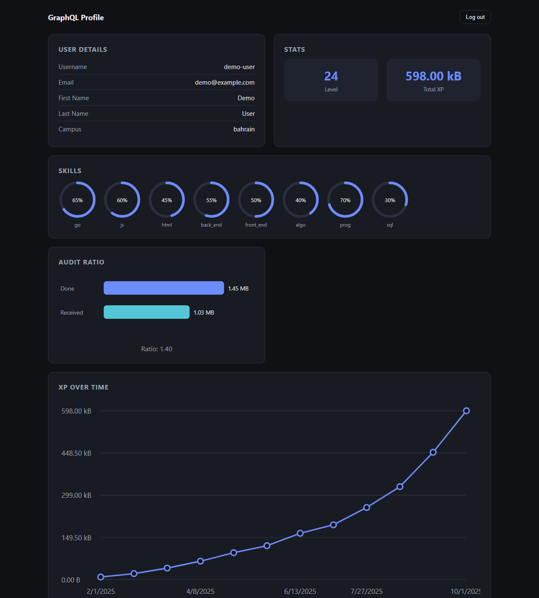
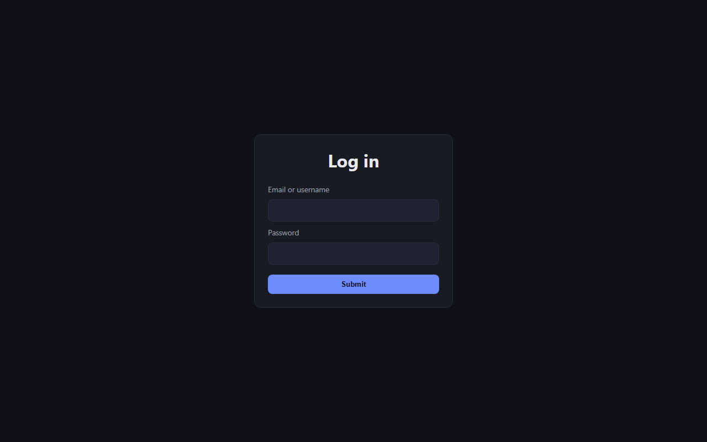

# GraphQL Profile

A personal profile dashboard that signs in to the Reboot01 (01 Edu) platform and uses its **GraphQL API** to show a student's progress. It displays XP, level, skills and audit ratio as hand-built **SVG charts**. It is written in vanilla JavaScript with no frameworks or chart libraries.



<sub>Screenshot rendered with sample data.</sub>

## Features

- **Authentication**: sign in with a username or email and password (Basic auth), get a **JWT** and store it for later requests; includes log out
- **GraphQL queries** for user details, the XP transaction timeline, skills, level and total XP, using filters such as `where`, `_eq`, `_nlike` and `_iregex`, plus aggregates
- **User details card**: username, email, name and campus
- **Stats**: current level and total XP
- **Custom SVG charts**, generated from scratch:
  - **XP over time**: a cumulative line chart of XP earned per project
  - **Audit ratio**: a bar comparison of audits done vs. received
  - **Skills**: ring charts showing each skill's percentage
- **Hash-based routing** (`#` login, `#profile` dashboard) with a guard that redirects to login when there is no token
- Loading and error states, plus HTML escaping of all API data

## Getting Started

The app is a static site and needs no build step. Serve it over HTTP, because it uses ES modules:

```bash
git clone https://github.com/ahmed-jawher/graphql.git
cd graphql
npx serve .          # or: python3 -m http.server 8000
```

Open the URL that is printed and sign in with your Reboot01 credentials.

| Login | Profile |
|---|---|
|  |  |

## Example Query

```graphql
query {
  user {
    login
    auditRatio
    totalUp
    totalDown
    timeline: transactions(where: { type: { _eq: "xp" } }) {
      amount
      createdAt
      path
    }
  }
}
```

## Project Structure

```text
graphql/
├── index.html
├── css/style.css
└── js/
    ├── app.js       # bootstrap
    ├── router.js    # hash routing and auth guard
    ├── auth.js      # login form handling
    ├── api.js       # sign-in and GraphQL queries
    ├── state.js     # token storage and profile state
    ├── views.js     # login, profile, loading and error views
    └── charts.js    # SVG chart rendering
```

## Author

**Ahmed Jawher** — [@ahmed-jawher](https://github.com/ahmed-jawher)
